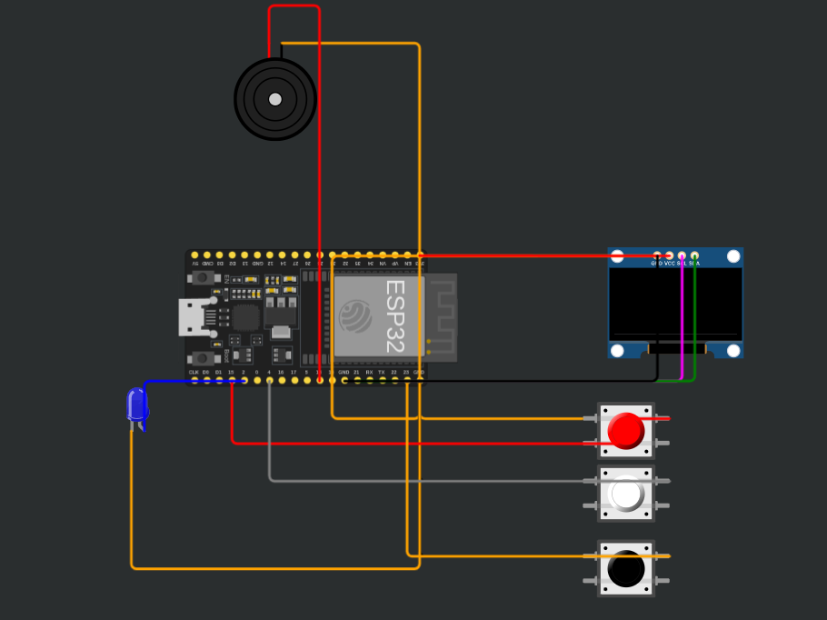

# ESP32-Morse

A high-performance, non-blocking hardware Morse code terminal built on the **ESP32** microcontroller. Designed with low-level register manipulation, asynchronous state timing, an I2C OLED display, and multi-sensory feedback (piezo-acoustic + optical indication).



---

## ⚡ Key Features

- **Asynchronous Architecture:** Zero blocking `delay()` calls. Everything runs on clean non-blocking `millis()` software timers and hardware registers.
- **Direct Register Manipulation:** High-speed LED output control directly via ESP32 GPIO registers (`GPIO.out_w1ts` / `GPIO.out_w1tc`) executing in a single CPU cycle.
- **Multi-Sensory Feedback:** 
  - Dynamic 750 Hz audio playback via a passive buzzer with standardized time constants (Dot: 100 ms, Dash: 300 ms).
  - Synchronous optical pulse indication via an external LED.
- **Hardware Human Interface (HID):**
  - Dedicated tactile keys for `Dot` (`.`) and `Dash` (`-`).
  - Native `Backspace` key with real-time character buffer popping.
  - Software debounce filtering preventing contact bounce and floating states.
- **Visual Display:** Real-time dual-line rendering on an SSD1306 0.96" I2C OLED display (128x64).

---

## 🛠 Hardware Architecture & Pinout

| Peripheral | ESP32 GPIO Pin | Mode | Description |
| :--- | :--- | :--- | :--- |
| **OLED SDA** | `GPIO 21` | I2C | Serial Data line |
| **OLED SCL** | `GPIO 22` | I2C | Serial Clock line |
| **Dot Button** | `GPIO 15` | `INPUT_PULLUP` | Enters a dot (`.`) |
| **Dash Button** | `GPIO 4` | `INPUT_PULLUP` | Enters a dash (`-`) |
| **Backspace** | `GPIO 23` | `INPUT_PULLUP` | Deletes the last character |
| **Buzzer** | `GPIO 18` | Output (`tone`) | 750 Hz acoustic output |
| **Signal LED** | `GPIO 2` | Direct Register | Optical indication |

> **Note:** All tactile buttons operate on active-low logic using ESP32 internal pull-up resistors (`INPUT_PULLUP`) and close directly to `GND`.

---

## 🚀 Getting Started

### Prerequisites
- [PlatformIO Core](https://platformio.org/) or VS Code with the PlatformIO IDE extension.
- ESP32 Development Board (NodeMCU / ESP-WROOM-32).

### Installation & Build

1. Clone this repository via SSH:
   ```bash
   git clone git@github.com:oppenheimer-dev/ESP32-Morse.git
   cd ESP32-Morse

2.  Build the firmware using PlatformIO:

    pio run

3.  Flash to your target board:

    pio run --target upload

4.  Launch serial telemetry (optional):

    pio device monitor -b 9600

📜 License

This project is open-source and distributed under the MIT License.

Built by Dr. Oppie
